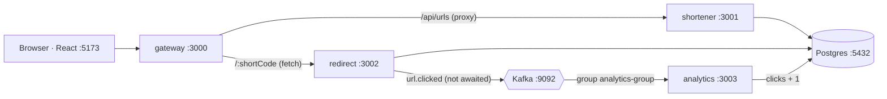

# URL Shortener

A URL shortener split into four Express services, with click analytics flowing through Kafka. I built it to learn how a backend behaves once it's split into services: where the boundaries go, how the services talk, and what happens when one of them fails. It started as a single Express app and was split once that version worked.

## Architecture



| Service | Port | Responsibility |
|---|---|---|
| `apps/backend` (gateway) | 3000 | Entry point for the frontend. Proxies `/api/urls` to the shortener with path rewriting; resolves `/:shortCode` through the redirect service. |
| `services/shortener` | 3001 | Creates short links (`nanoid(7)`) and lists them. |
| `services/redirect` | 3002 | Looks up a code, publishes a `url.clicked` event, returns a 302. |
| `services/analytics` | 3003 | Consumes `url.clicked` and increments the link's click count. |
| `apps/frontend` | 5173 | React 19 + Vite + Tailwind + shadcn/ui. |

### Opening a short link

1. The gateway calls the redirect service with `redirect: "manual"`, so it receives the 302 instead of following it.
2. The redirect service finds the code via a unique index on `shortCode`.
3. It publishes a click event to Kafka **without awaiting it**, so analytics never adds latency to the redirect.
4. It returns a 302, which the gateway passes to the browser.
5. Separately, the analytics service consumes the event and runs an atomic `UPDATE ... SET clicks = clicks + 1`.

## Running it

Requires Docker with Compose.

```bash
docker compose up --build -d

# first run only: create the table
docker compose exec -w /app/services/shortener shortener npx prisma migrate deploy
```

Then open http://localhost:5173. Follow click events with `docker compose logs -f analytics`.

Compose waits for Postgres (`pg_isready`) and Kafka (topic listing) to pass their healthchecks before starting the services that need them. Kafka runs in KRaft mode, so there's no ZooKeeper.

## API

| Method | Path (via gateway) | Result |
|---|---|---|
| `POST` | `/api/urls` with `{ "originalUrl": "https://..." }` | `201` with the created link |
| `GET` | `/api/urls` | All links, newest first, with click counts |
| `GET` | `/api/urls/:shortCode` | One link, or `404` |
| `GET` | `/:shortCode` | `302` to the original URL, or `404` |

Each service also exposes `GET /health`. The analytics service serves `GET /analytics/:shortCode` directly on port 3003.

## Design decisions

- **Clicks are counted from events, not inside the redirect.** The redirect is the hot path. Moving the counter write onto Kafka keeps links working while analytics is slow, down, or being redeployed.
- **Fire-and-forget publish.** This trades a possible lost click (if Kafka is unreachable) for zero added redirect latency. That's acceptable for a counter, but not for data that matters.
- **Uniqueness enforced by the database.** A unique index on `shortCode` rejects duplicates even when two inserts race. The same index serves the redirect lookup.
- **Atomic increment.** Prisma's `increment` compiles to a single `UPDATE`, so concurrent consumers can't overwrite each other's counts.

## Known limitations and next steps

- **Shared database.** All three services use the same `Url` table. Next step: give analytics its own click store, fed only by events.
- **Internal service ports are published to the host,** and analytics has no gateway route. In a real deployment only the gateway would be exposed.
- **Startup depends on Kafka.** The redirect service waits for the Kafka producer to connect before it starts listening. It should start first and connect in the background.
- **Clicks can be lost or double-counted.** Publishing is at-most-once and consuming is at-least-once. Fix: an event ID per click plus an idempotent write.
- **No retry on short-code collision,** and no URL validation (only presence is checked).
- **No cache on the redirect path.** The code → URL mapping never changes, so it's an easy candidate for Redis.
- **Migrations are a manual step,** the topic has a single partition, and `GET /api/urls` has no pagination or auth.

## Stack

Node.js 22, Express 5, Prisma 6, PostgreSQL 16, Apache Kafka 3.7 (kafkajs), Docker Compose, npm workspaces, React 19, Vite, Tailwind CSS 4, shadcn/ui.
